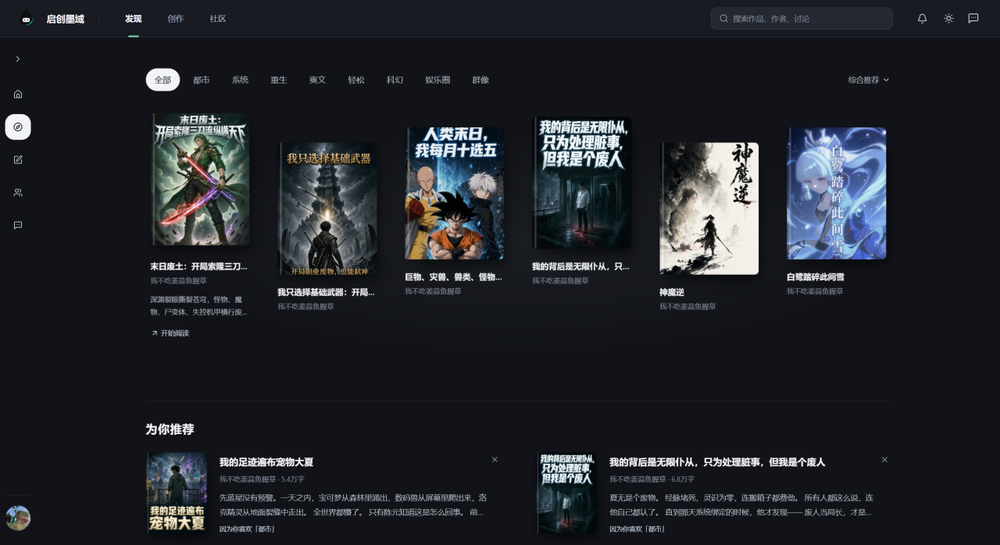
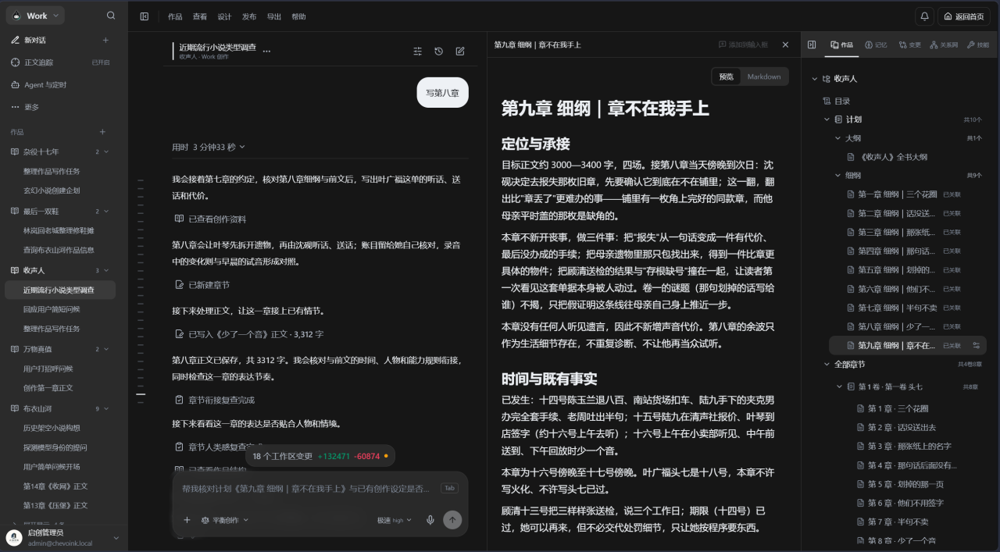
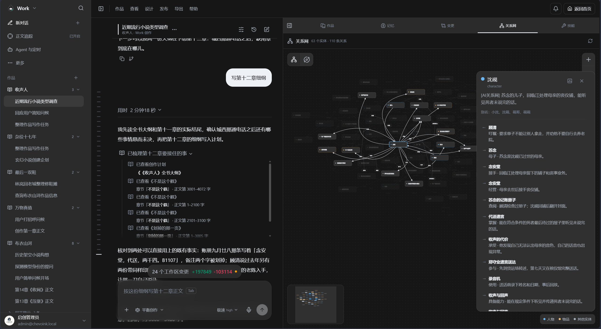
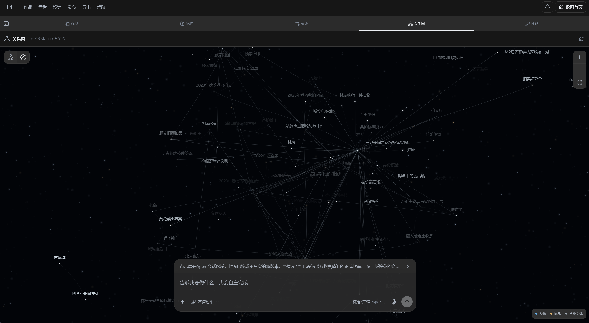
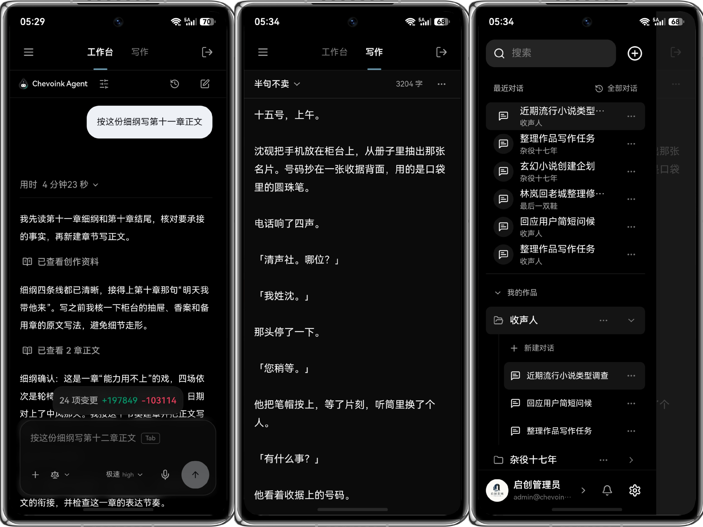
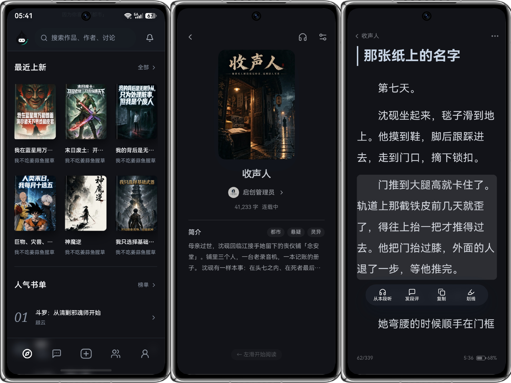
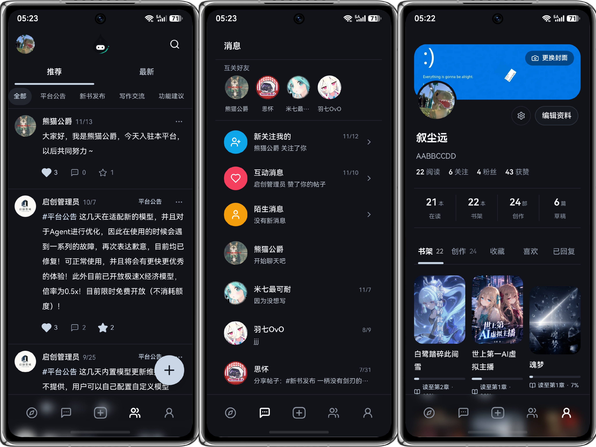
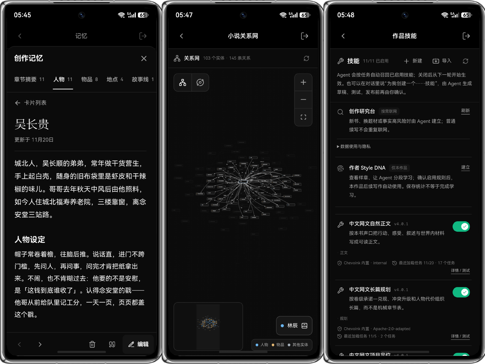
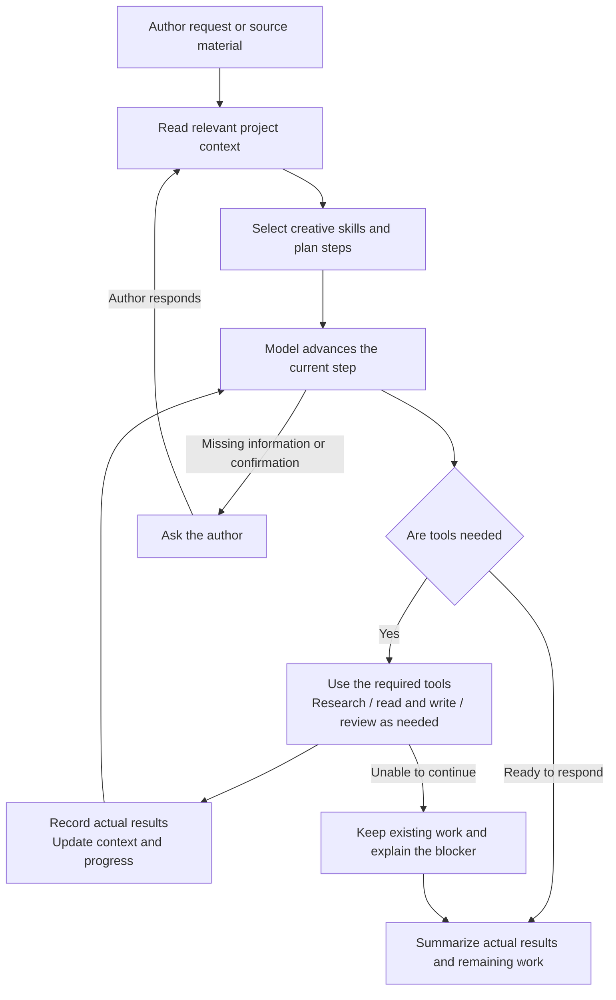
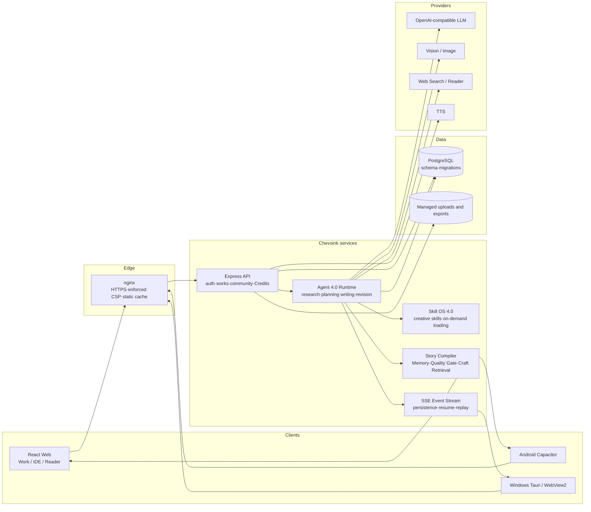

<p align="center">
  <a href="https://chevoink.chevolink.com">
    
  </a>
</p>

<h3 align="center">A spark of inspiration. A world in words.</h3>

<p align="center">
  Your AI creative partner, connecting ideas, stories, and readers.<br>
  Research, plan, write, and revise with Chevoink Agent — a home for creating novels and discovering, reading, and sharing stories.<br>
  <sub>Web · Windows · Android</sub>
</p>

<p align="center">
  <a href="https://github.com/Xcy8010/chevoink/releases"></a>
  <a href="https://github.com/Xcy8010/chevoink/actions/workflows/ci.yml"></a>
  <a href="https://github.com/Xcy8010/chevoink/stargazers"></a>
  <a href="#license"></a>
  <a href="#community"></a>
</p>

<p align="center">
  <a href="https://chevoink.chevolink.com"><strong>Try Online</strong></a> ·
  <a href="#product-preview">Preview</a> ·
  <a href="#feature-overview">Features</a> ·
  <a href="#quick-start">Quick Start</a> ·
  <a href="https://github.com/Xcy8010/Chevoink/releases/latest">Download</a> ·
  <a href="#community">Community</a>
</p>

<p align="center"><a href="./README.md">简体中文</a> · <strong>English</strong></p>

---

## Product Preview

### Desktop

<table>
  <tr>
    <td align="center"><a href="docs/assets/previews/desktop-discover.png"></a><br>Discover and book recommendations</td>
    <td align="center"><a href="docs/assets/previews/desktop-studio.png"></a><br>Writing chat and chapter outline</td>
  </tr>
  <tr>
    <td align="center"><a href="docs/assets/previews/desktop-relationships.png"></a><br>Character relationships</td>
    <td align="center"><a href="docs/assets/previews/desktop-galaxy.png"></a><br>3D galaxy view</td>
  </tr>
</table>

### Mobile

<table>
  <tr>
    <td align="center"><a href="docs/assets/previews/mobile-writing.jpg"></a><br>Writing workspace, editor and chats</td>
    <td align="center"><a href="docs/assets/previews/mobile-reading.jpg"></a><br>Discovering and reading a book</td>
  </tr>
  <tr>
    <td align="center"><a href="docs/assets/previews/mobile-community.jpg"></a><br>Community, messages and bookshelf</td>
    <td align="center"><a href="docs/assets/previews/mobile-memory.jpg"></a><br>Story memory, relationships and skills</td>
  </tr>
</table>

## Chevoink Agent 4.0

Chevoink Agent is an AI writing partner built around your work. It helps authors research, develop story settings, plan plots, draft chapters and revise manuscripts.

- **Creative workspace** supports Work, IDE and mobile layouts. Send a message on your phone and follow the same conversation and writing task on your computer. Under Settings → Devices, you can check each device’s network location and last activity, and use your password to sign out a particular device.
- **Project knowledge and skills**: write with story settings, knowledge collections and creative skills, including personal skills.
- **Review and revision**: use continuity and writing-quality checks to locate issues, revise passages and save versions.
- **Story memory** tracks characters, items and plot threads as you continue a novel. Open a card to see what changed, or explore its connections in the relationship graph.
- **Web research** lets the Agent search and open sources. With a text-only model, explicitly ask to search the web. If the task already has permission, the platform returns sourced material to the same model for its answer.
- **Writing progress** shows what the Agent is checking or writing. Expand an activity to see the individual tool results.

Use built-in models, custom OpenAI-compatible services, or a local connector for LM Studio and Ollama. The computer hosting a local model must stay online. See [local model setup](docs/LOCAL-MODELS.en.md).

### Runtime flow

The Agent works within the current project, chooses tools as needed, and uses actual execution results to decide the next step.



Drafts and revisions are saved through actual write operations; reviews follow the task's requirements. Chat, research and planning do not have to enter chapter writing or review. The final reply explains **what was created or changed, where it was saved, and what remains unfinished**. Execution progress is visible in the task window.

### System architecture



### Continuing work and choosing models

Tasks retain project context and creative material. Use Continue to return to a paused task, and view progress and history in the task window.

Studio settings let you assign built-in or custom models and reasoning efforts to different kinds of work, globally or per novel. You can also request a model or writing-mode change in chat. Model usage and tool charges are available on the account usage page.

When you switch tasks, cached conversations appear immediately. If a chapter, model setting or side panel takes longer to load, only that area shows a placeholder. Reopening Memory shows the last known progress and card counts while updated values arrive.

## Quick Navigation

| What you want | Where to go |
| --- | --- |
| Try the product now | [Live site](https://chevoink.chevolink.com) (web, no install needed) |
| Install the Android app | [Download & install guide](#download-and-install) · [Releases page](https://github.com/Xcy8010/chevoink/releases) |
| Install the Windows client | [Choose a Windows installer](#download-and-install) · [Windows client guide](desktop/windows/README.md) |
| Learn how to use it | [User guide](#user-guide) |
| Explore features | [Feature overview](#feature-overview) |
| Understand Agent 4.0 | [Runtime flow](#runtime-flow) · [System architecture](#system-architecture) |
| Run it locally | [Quick start](#quick-start) |
| Understand the architecture | [Tech stack](#tech-stack) · [Directory structure](#directory-structure) |
| Deep engineering details | [Engineering Documentation](./docs/ENGINEERING.en.md) ([中文](./docs/ENGINEERING.md)) · [Development Standards](./docs/DEVELOPMENT-STANDARDS.en.md) ([中文](./docs/DEVELOPMENT-STANDARDS.md)) · [Agent evaluation guide (Chinese)](./tests/agent-evals/README.md) |
| Deploy to production | [Deployment & releases](#deployment--releases) · [Environment variables](#environment-variables) |
| Chat with us | [QQ group 158443235](#community) |

## Download and install

The [latest GitHub release](https://github.com/Xcy8010/Chevoink/releases/latest) includes the Windows installers, Android APK, release notes and SHA-256 checksums.

| Device | Download | Installation and updates |
| --- | --- | --- |
| Windows x64 with WebView2 installed or internet access to obtain it | Windows 1.0.6 standard installer, ending in `_x64-setup.exe` | Run the installer. Install subsequent desktop client updates manually. |
| Windows x64 needing an offline WebView2 installation | Windows 1.0.6 installer with `webview2-offline` in its name | The installer includes the runtime. Both packages provide the same Studio features. |
| Android | Signed Android 1.0.18 APK, also available as a [direct download](https://chevoink.chevolink.com/download/chevoink.apk) | Install the APK. The app checks for updates and prompts you to download and confirm installation. |

The current Windows installers are distributed unsigned for manual installation. External links and the account center open in the system's default browser. Studio on the web and inside the clients follows the web release selected for the account.

## User Guide

### Readers

1. **Create an account or sign in**. New users register with an email verification code and accept the current Terms of Service and Privacy Policy. After registration, you can verify your phone, set a password, and complete your profile. Each step can be skipped. Existing users can sign in with an email address or phone number using a password or a code sent to that address or number. Older phone accounts with no saved email address must add one after signing in.
2. **Find books**: browse by genre on Discover, explore personalized recommendations, or search for books, authors and community discussions.
3. **Read**: page-flip navigation inside the reader; tap the center to summon the menu for font size, typeface, paper theme and flip mode; reading progress and bookshelf sync to the cloud, so you can continue on another device;
4. **Listen**: enable TTS narration in the reader, with selectable voices and speeds; flip mode shows a bottom playback capsule;
5. **Interact**: comment, like and bookmark on the book detail page; post, join topics, follow authors and chat in the community.

### Authors

1. Verify your phone to enter **Studio**, then create a novel or describe your writing idea to the Agent.
2. Write in the chapter editor or ask **Chevoink Agent 4.0** to help with research, settings, outlines, chapter drafts and revisions.
3. Browse built-in skills and manage personal skills in **Work Skills**.
4. Attach up to 6 images and 3 files per message. The Agent can read Chinese TXT, Markdown, PDF and DOCX in sections, and inspect scanned PDF pages and embedded DOCX images when needed. Legacy DOC requires the document converter, or you can save it as DOCX. ZIP files are used for project import.
5. Generate a cover with AI or upload your own PNG, JPEG or WebP image, up to 10 MiB per cover.
6. **Export your work** from the toolbar or More menu, choosing plans, contents, chapters and work information.
7. Search, pin or archive tasks and manage work versions and creative records in the **Agent Operations Center**.
8. Publish chapters or schedule updates through chapter management.

### Public-beta Credits

- When the public beta is enabled, the default allowance is **450 Credits per day** and the default reset time is **15:00 UTC+8**. The account usage page shows the allowance in effect. Referral rewards live in a separate balance and survive daily resets.
- Text uses a bundled allowance: **at base multiplier m=1, 1 Credit includes both 10,000 input tokens and 1,000 output tokens**. Charging uses the larger utilization ratio instead of adding input and output charges. Image generation has a base price of 6 Credits per call. During a promotion, the price is fixed when the request is admitted. A web search costs 2 Credits per call.
- Every user gets a unique referral URL. Only a brand-new account can redeem it on first registration: the inviter receives 300 Credits and the invitee receives 120 Credits; each invitee can redeem exactly once.
- Studio warns at 20%, 10%, and 5% remaining. Exhaustion safely stops the task; [`/account/usage`](https://chevoink.chevolink.com/account/usage) shows the plan, balances, and itemized ledger.
- Models expose supported reasoning efforts only and use their configured default strength. BYOK text has no platform text charge; keys are encrypted and never returned. Other platform tool fees remain separate.

## Feature Overview

- **Reading**: book discovery, rankings and personalized recommendations, cloud-synced bookshelf & reading progress, immersive reader, TTS narration
- **Studio**: Codex-inspired Work/IDE workspace; Agent 4.0 with Research Dossier, Skill OS, Story Compiler, Chapter Bridge, human-quality gate, licensed craft retrieval, work-private Style DNA, first-three-chapter prototyping, and blind-review pipeline; cross-novel task search/pin/archive; branch/diff/conflict-safe merge; embedded subagents; schedules; permission sandbox; replay; multimodal attachments; web/in-platform research; cross-session memory; relationship graph; AI covers; and scoped ZIP export
- **Community**: posts & topics, recommendation algorithm, comments/likes/bookmarks, follows & fans, direct messages with online presence
- **Accounts** with email-code registration, email or phone sign-in, code-based password recovery, HttpOnly cookie sessions and client Bearer tokens, public-beta Credits, and one-time referral rewards
- **Admin console**: data dashboard, user/novel/content governance, encrypted built-in-model configuration, single-user and bulk Credits reset/pause controls, token ranking with user/novel/task drill-down, web-search and image-generation call counts, mobile-friendly
- **Android client**: Capacitor shell loading the remote site, in-app update checks and APK distribution

## Tech Stack

| Layer | Technology |
| --- | --- |
| Frontend | React 18 · Vite 6 · TypeScript · TailwindCSS · React Query 5 · Zustand 5 · React Router 7 |
| Backend | Express 4 · Prisma 6 · PostgreSQL · Zod |
| AI | built-in and custom text models · configurable vision models · OpenAI-compatible image generation · Edge TTS speech synthesis · platform web search and page fetching with configurable search providers and fallback engines |
| Agent | Agent 4.0 Runtime (`api/lib/agent`): creative skills, project memory, chapter planning, research, review and real-time events |
| Testing | Vitest + Supertest + Testing Library (unit, PostgreSQL integration and UI interaction) |
| Deployment | PM2 + nginx · GitHub Actions (type check, lint, full coverage suite with isolated PostgreSQL, build, Agent evaluation, production and full dependency audits) |

## Directory Structure

```
├── api/               # Express backend (routes, lib business modules, config)
├── src/               # React frontend (app shell & routes, feature domains, shared components)
├── shared/contracts/  # Type contracts shared by frontend & backend
├── prisma/            # Data model schema, migrations, seed data
├── tests/             # Unit, PostgreSQL integration, UI interaction, Chevoink-CN-Fiction-Eval
├── docs/              # Engineering docs (ENGINEERING & DEVELOPMENT-STANDARDS, both bilingual)
├── plan/              # Design proposals and roadmap
├── deploy/            # nginx config & server deployment scripts
├── scripts/           # Workspace checks, CI, evaluation, and releases
├── desktop/windows/   # Tauri / WebView2 Windows client (main)
└── public/            # Static assets
```

## Quick Start

Work from the repository root on `main` with Node **22.23.2** and npm **10.9.8**. The setup command installs locked dependencies, verifies the runtime, and generates Prisma Client.

```sh
node scripts/start-work.mjs
node scripts/cloud-setup.mjs --install
cp .env.example .env
```

Use `Copy-Item .env.example .env` in Windows PowerShell. Fill in your local development settings and connect to a dedicated development PostgreSQL database before applying migrations to it. Vite proxies `/api` to the default API port 3001.

```sh
npm run prisma:migrate:deploy
npm run dev
```

Common scripts:

| Command | Description |
| --- | --- |
| `npm run dev` | Frontend + backend parallel development |
| `npm run check` | TypeScript type check |
| `npm test` | Run Vitest. Full database checks require a separately configured isolated test database. |
| `npx vitest run --coverage` | Generate coverage. CI applies its thresholds after merging all shards. |
| `npm run agent3:eval` | Emit a versioned Agent 4.0 deterministic eval snapshot with hashes and code SHA |
| `npm run lint` | ESLint check |
| `npm run build` | Production build |
| `pwsh -NoProfile -File scripts/deploy-production.ps1 -ExpectedCurrentRevision <full-live-SHA> -CiRunId <CI-run-ID>` | Authorized same-SHA CI deployment through PowerShell 7 |

## Deployment & Releases

- Web and API source live on `main`. A frontend-only release promotes an immutable build through the [web release channels](docs/APP-RELEASES.md) after full CI passes for the same commit. API deployments use the PowerShell entrypoint above and the observed live SHA.
- **Android** builds the Capacitor shell from `android/` on the `android-shell` branch of this repository. APKs are distributed through [Releases](https://github.com/Xcy8010/chevoink/releases).
- **Windows** source lives in `desktop/windows/` on `main`. The `chevoink-windows` branch is historical. See the [Windows client guide](desktop/windows/README.md).

## Environment Variables

All secrets are injected via `.env` (database, session signing, Tencent Cloud SMS, AI services, etc.); the template is at [.env.example](.env.example). Model API keys are encrypted at rest with AES-256-GCM. Production must use a dedicated `MODEL_CONFIG_ENCRYPTION_KEY`; back it up and rotate it deliberately, because losing it makes stored keys undecryptable. Sensitive files such as `.env`, certificates and keystores are excluded by `.gitignore` and never enter the repository.

## Community

Join the **Chevoink community group** (QQ group: `158443235`) to discuss the experience, report issues or contribute:

[Join the QQ group](https://qun.qq.com/universal-share/share?ac=1&authKey=O%2Bhtn0O51Qt5fW67Pj%2BSV7v0QI1%2FESTce7xHduNryLjTadVyekW9TMJcs0Wd5Qap&busi_data=eyJncm91cENvZGUiOiIxNTg0NDMyMzUiLCJ0b2tlbiI6ImdkU3I4ckRWR1M1L3hjTklTTGxHUnVYdVJ6bFNJeXN0c2ozbk1qd0pEeXpZb0JrdkZsbVNyUGtXY3lHZUFGYXQiLCJ1aW4iOiIyNDQ5MTI5ODYyIn0%3D&data=ys8RFeB2nMSORLKaLMkGLLRE8N8WU2t9WCjktU9Dg5YogAZktMZLLLMTj5t2KvcXA8K4p4J2NLPUEV0FO9OpRw&svctype=4&tempid=h5_group_info)

## Contributors and team

<p>
  <a href="https://github.com/Xcy8010"></a>
  <strong><a href="https://github.com/Xcy8010">XCY</a></strong> · Project contributor<br>
  Contributes to all development and maintenance work on Chevoink, and shares source code and releases on GitHub.
</p>
<br clear="left">

<p>
  <a href="https://chevolink.com"></a>
  <strong><a href="https://chevolink.com">Chevolink · 启创联科网络科技工作室</a></strong> · Development team<br>
  The studio behind Chevoink, developing the tools authors use to write and readers use to enjoy their stories.
</p>
<br clear="left">

## License

This project is open-sourced under the [GNU AGPL-3.0 License](LICENSE): free to use, modify, and distribute. **If you provide it as an online service (SaaS / web server), you must offer the corresponding, modifiable source code to that service's users.** Closed-source commercial deployment requires a separate [commercial licence](./docs/COMMERCIAL-LICENSE.md) from the original author.

## Special Thanks

Chevoink is independently designed and implemented. The following open-source projects provided important references during the evolution of Agent 4.0, the novel domain model, and the Studio experience:

| Open-source project | Referenced area in Chevoink | What we learned from it |
| --- | --- | --- |
| [OpenAI Codex](https://github.com/openai/codex) | Writing Agent Loop, Work mode, task/tool execution, context organization | Agent-first workflows, traceable tool calls, continuous long-running tasks, context compaction, restrained workspace hierarchy, and collapsible sidebars |
| [OpenFic](https://github.com/syrizelink/OpenFic) | IDE mode, work tree, volume/chapter structure, novel retrieval, and writing Skills | Novel-focused IDE information architecture, the `Volume → Chapter` domain model, persisted panel layouts, chapter retrieval flows, and open-ended writing capabilities |
| [TencentDB Agent Memory](https://github.com/TencentCloud/TencentDB-Agent-Memory) | Long-form Agent story memory, character relationships, events, and conflict review | Layered memory, provenance and revision tracking, hybrid retrieval, memory updates, and conflict-governance patterns |
| [DeepSeek Harness](https://github.com/deepseek-ai/deepseek-harness) | Reasoning and tool-activity UI in Work / IDE | Progressive disclosure of reasoning, execution-state communication, and compact visual hierarchy for tool-call history |
| [React Flow / xyflow](https://github.com/xyflow/xyflow) | Story-memory relationship graph | Chevoink directly uses `@xyflow/react` for viewport panning, zooming, fit-to-view, controls, and minimap navigation |

These projects primarily informed architecture research, product interaction, and engineering principles. Except for third-party software explicitly declared in the dependency manifests, Chevoink's business code is redesigned and implemented for its own stack and novel-writing use cases. Our sincere thanks go to their maintainers and contributors for advancing the open-source Agent and creative-tool ecosystem.
