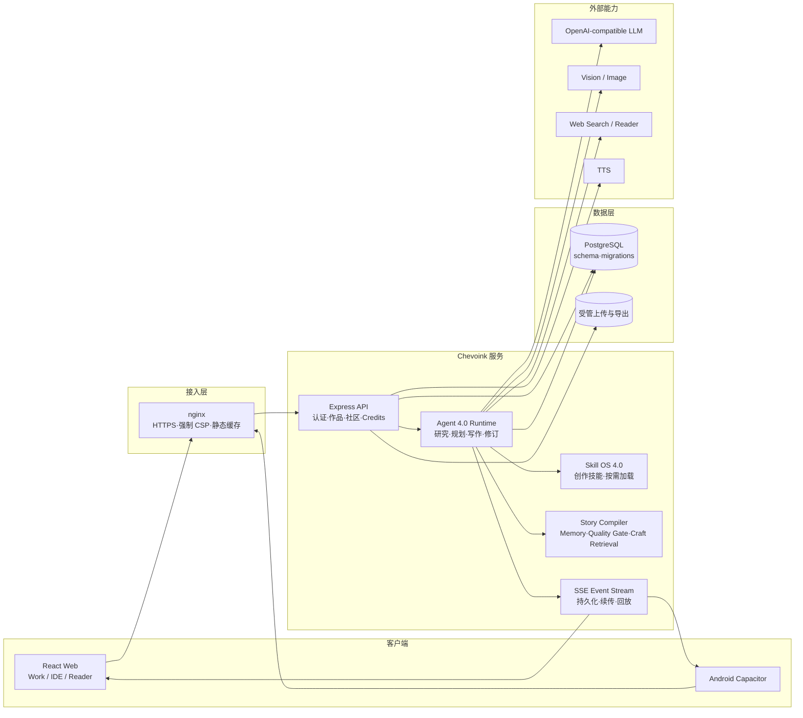

<p align="center">
  <a href="https://chevoink.chevolink.com">
    
  </a>
</p>

<h3 align="center">一念启创，落墨成域。</h3>

<p align="center">
  以 AI 为创作伙伴，连接灵感、作品与读者。<br>
  与 Chevoink Agent 一起研究、规划、写作与改稿，在这里创作小说，也发现、阅读与分享故事。<br>
  <sub>Web · Windows · Android</sub>
</p>

<p align="center">
  <a href="https://github.com/Xcy8010/chevoink/releases"></a>
  <a href="https://github.com/Xcy8010/chevoink/actions/workflows/ci.yml"></a>
  <a href="https://github.com/Xcy8010/chevoink/stargazers"></a>
  <a href="#license"></a>
  <a href="#交流群"></a>
</p>

<p align="center">
  <a href="https://chevoink.chevolink.com"><strong>在线体验</strong></a> ·
  <a href="#产品预览">产品预览</a> ·
  <a href="#功能一览">核心能力</a> ·
  <a href="#快速开始">快速开始</a> ·
  <a href="https://github.com/Xcy8010/chevoink/releases">客户端下载</a> ·
  <a href="#交流群">社区交流</a>
</p>

<p align="center"><strong>简体中文</strong> · <a href="./README.en.md">English</a></p>

---

## 产品预览

**桌面端**

<table>
  <tr>
    <td align="center"><br>书城与阅读链路</td>
    <td align="center"><br>创作区与 AI 写作 Agent</td>
  </tr>
</table>

**移动端**

<table>
  <tr>
    <td align="center"><br>手机端首页与社区</td>
    <td align="center"><br>手机端创作与阅读</td>
  </tr>
</table>

## Chevoink Agent 4.0

Chevoink Agent 是围绕作品协作的 AI 创作伙伴，帮助作者研究资料、梳理设定、规划情节、撰写章节和修改稿件。

- **创作工作区**：在 Work、IDE 和手机端管理作品、章节与创作任务。
- **作品资料与技能**：结合设定、知识集和创作技能开展写作，支持管理个人技能。
- **审校与修订**：提供章节连续性与表达质量检查，辅助定位问题、修改和保存版本。
- **可见进展**：在对话中查看模型返回的思考、工具活动和工作区变更，随时审阅结果。

支持内置模型、自定义 OpenAI 兼容服务，以及通过本地连接器接入 LM Studio、Ollama 等本地模型。本地模型所在电脑需保持在线，配置方式见[本地模型说明](docs/LOCAL-MODELS.md)。

### 系统架构




### 连续创作与模型选择

在原任务中保留作品上下文和创作资料，暂停后可点击「继续」，也可在任务窗口查看进度与历史。

在创作区设置的「模型分工」中，为不同工作选择内置或自定义模型及推理强度；设置可应用于全局或当前作品。也可以直接在对话中要求切换模型或创作模式。模型用量和工具费用可在账户用量页查看。

## 快速导航

| 想做什么 | 去哪里 |
| --- | --- |
| 直接体验产品 | [线上地址](https://chevoink.chevolink.com)（网页端，无需安装） |
| 安装安卓 APP | [下载与安装教程](#下载与安装安卓-app) · [Releases 页面](https://github.com/Xcy8010/chevoink/releases) |
| Windows 客户端开发 | [构建说明](desktop/windows/README.md) · [开发状态](docs/WINDOWS_DESKTOP.md)；当前为内部候选版，尚未正式签名发布 |
| 了解怎么用 | [使用教程](#使用教程) |
| 了解功能 | [功能一览](#功能一览) |
| 了解 Agent 4.0 | [创作能力与模型选择](#chevoink-agent-40) |
| 本地跑起来 | [快速开始](#快速开始) |
| 了解架构 | [技术栈](#技术栈) · [目录结构](#目录结构) |
| 深入工程细节 | [工程文档](./docs/ENGINEERING.md)（[English](./docs/ENGINEERING.en.md)）· [开发规范](./docs/DEVELOPMENT-STANDARDS.md)（[English](./docs/DEVELOPMENT-STANDARDS.en.md)）· [Agent 评测说明](./tests/agent-evals/README.md) |
| 部署上线 | [部署与发布](#部署与发布) · [环境变量](#环境变量) |
| 交流讨论 | [QQ 交流群 158443235](#交流群) |

## 下载与安装（安卓 APP）

两种方式任选其一：

1. **GitHub Releases（推荐）**
   - 打开 [Releases 页面](https://github.com/Xcy8010/chevoink/releases)，进入最新版本（如 `v1.50`）；
   - 在 Assets 中下载 `chevoink-vX.XX.apk` 到手机；
   - 点击安装。系统若提示「未知来源应用」，在弹窗中允许「本次安装」即可（APK 已使用发布密钥签名）。
2. **官网直装**
   - 手机浏览器访问 <https://chevoink.chevolink.com/download/chevoink.apk> 直接下载安装。

安装后无需手动升级：APP 启动时会自动检测新版本，站内条幅 / 设置页会提示更新并引导下载。网页端用户打开线上地址即是最新版。

## 使用教程

### 读者

1. **登录**：手机号 + 短信验证码，无需注册流程，首次登录自动建号；
2. **找书**：书城首页有轮播、榜单与分类推荐，也可搜索书名/作者；
3. **阅读**：进入正文后左右翻页，点击屏幕中央呼出菜单，可调字号、字体、纸色主题、翻页方式；阅读进度与书架自动云同步，换设备接着读；
4. **听书**：阅读器内开启 TTS 听书，支持切换音色与语速，翻页模式下有底部播放胶囊；
5. **互动**：书籍详情页可评论、点赞、收藏；社区区可发帖、参与话题、关注作者、私信聊天。

### 作者

1. 进入**创作区**，创建作品或直接向 Agent 描述你的创作想法。
2. 在章节编辑器写作，或让 **Chevoink Agent 4.0** 协助资料研究、设定、大纲、章节起草与修订。
3. 在**作品技能**区查看内置技能、管理个人技能，选择适合当前作品的写作方式。
4. 随提示词附加**图片（≤6 张）与文件（≤3 个，pdf/docx/txt/md）**，在对话中查看附件内容。
5. 使用 **AI 封面生成**制作封面，也可以让 Agent 查看当前封面。
6. 从工具栏或「更多」菜单**导出作品**，按需选择规划、目录、章节和作品信息。
7. 在 **Agent 操作中心**搜索、置顶或归档任务，管理作品版本与创作记录。
8. 通过章节管理发布作品，或设置定时更新。

### 公测 Credits

- 公测账户每天获得 **450 Credits**，在 **UTC+8 15:00** 重置；邀请奖励为独立余额，不随每日重置清零。
- 文本采用同时包含两类额度的套餐口径：**基础倍率 m=1 时，1 Credit 同时包含 10,000 输入 Token 与 1,000 输出 Token**，按两者使用比例的较大值扣费，而不是输入、输出分别相加；生图每次 6 Credits，联网搜索每次 2 Credits。
- 每位用户都有唯一邀请链接。仅新用户首次注册可领取：邀请人获得 300 Credits，被邀请人获得 120 Credits；同一新用户只能兑现一次。
- 余额低于 20% / 10% / 5% 时创作区提醒；用尽后安全停止任务，并可在 [`/account/usage`](/account/usage) 查看套餐、余额和逐笔记录。
- 模型只显示自身支持的推理档位；默认使用对应模型配置的强度。BYOK 文本不收平台文本 Credits，密钥加密保存、不回显；其他平台工具费用独立。

## 功能一览

- **阅读区**：书城首页（轮播、榜单、分类推荐）、书架与阅读进度云同步、沉浸式阅读器、TTS 听书
- **创作区**：Codex 风格 Work/IDE 工作区、Agent 4.0（Research Dossier、Skill OS、Story Compiler、Chapter Bridge、人类感质量门、合法技法检索、作者私有 Style DNA、前三章试制与专家盲评链路）、跨作品任务搜索/置顶/归档、分支/差异/冲突安全合并、内嵌子 Agent、定时任务、权限沙箱、运行回放、多模态附件、联网与站内调研、跨会话记忆、作品关系网、AI 封面与范围化 ZIP 导出
- **社区**：帖子与话题系统、推荐算法、评论/点赞/收藏、关注与粉丝、私信与在线状态
- **账号体系**：手机号验证码登录（腾讯云短信）、HttpOnly Cookie 会话 + Bearer 备选通道（安卓壳杀后台不掉登录）、公测 Credits 与唯一邀请奖励
- **管理后台**：数据看板、用户/作品/内容治理、内置模型与加密密钥管理、Credits 单用户与批量重置/暂停、Token 用量排行与创作任务下钻、联网/生图调用统计、移动端适配
- **安卓客户端**：Capacitor 壳加载远程站点，应用内检测更新与 APK 分发

## 技术栈

| 层 | 技术 |
| --- | --- |
| 前端 | React 18 · Vite 6 · TypeScript · TailwindCSS · React Query 5 · Zustand 5 · React Router 7 |
| 后端 | Express 4 · Prisma 6 · PostgreSQL · Zod |
| AI | DeepSeek 文本生成 · 智谱 GLM-4.1V 图像理解 · OpenAI 兼容图像生成 · Edge TTS 语音合成 · 博查联网搜索（多引擎降级） |
| Agent | Agent 4.0 Runtime（`api/lib/agent`）：创作技能、作品记忆、章节编排、研究与审校、实时事件流 |
| 测试 | Vitest + Supertest + Testing Library（单元、PostgreSQL 集成与界面交互） |
| 部署 | PM2 + nginx（生产）· GitHub Actions CI（push 即跑类型检查/lint/单测/集成测试）· 安卓 Capacitor 壳工程（独立仓库目录） |

## 目录结构

```
├── api/               # Express 后端（routes 路由、lib 业务模块、config 环境配置）
├── src/               # React 前端（app 壳与路由、features 业务域、components 通用组件）
├── shared/contracts/  # 前后端共享的类型契约
├── prisma/            # 数据模型 schema 与迁移、种子数据
├── tests/             # 单元、PostgreSQL 集成、UI 交互与 Chevoink-CN-Fiction-Eval
├── docs/              # 工程文档（ENGINEERING 与 DEVELOPMENT-STANDARDS，均中英文双语）
├── plan/              # 设计方案与路线图
├── deploy/            # nginx 配置与服务器部署脚本
├── scripts/           # 部署 / 推送 / 数据清理脚本
└── public/            # 静态资源
```

## 快速开始

```bash
# 1. 使用 .node-version 指定的 Node 22.23.2 / npm 10.9.8，再安装锁定依赖
npm ci

# 2. 配置环境变量（参考 .env.example，填入数据库连接、AI Key 等）
copy .env.example .env

# 3. 初始化数据库
npm run prisma:generate
npm run prisma:migrate:deploy
npm run prisma:seed   # 可选：种子数据

# 4. 启动开发（前端 Vite + 后端 nodemon 并行）
npm run dev
```

常用脚本：

| 命令 | 说明 |
| --- | --- |
| `npm run dev` | 前后端并行开发 |
| `npm run check` | TypeScript 类型检查 |
| `npm run test` | 运行全部 Vitest 测试 |
| `npx vitest run --coverage` | 运行测试并执行本地/CI 双基线覆盖率门禁 |
| `npm run agent3:eval` | 生成带版本、Hash 与代码 SHA 的 Agent 4.0 确定性评测快照 |
| `npm run lint` | ESLint 检查 |
| `npm run build` | 生产构建 |
| `pwsh -NoProfile -File scripts/deploy-production.ps1 -ExpectedCurrentRevision <线上完整SHA> -CiRunId <CI编号>` | 已授权的同 SHA CI 维护部署（PowerShell 7） |

## 部署与发布

- **Web/API**：使用上方 `scripts/deploy-production.ps1` 入口，指定当前线上完整 SHA 和通过的同提交 CI；详细配置见[工程文档](docs/ENGINEERING.md)与[云端开发说明](docs/CLOUD-DEVELOPMENT.md)。
- **Android**：由独立 Capacitor 壳工程构建，通过 [Releases](https://github.com/Xcy8010/chevoink/releases) 分发 APK。
- **Windows**：开发和打包方式见[Windows 客户端说明](desktop/windows/README.md)。

## 环境变量

所有密钥通过 `.env` 注入（数据库、会话签名、腾讯云短信、AI 服务等），模板见 [.env.example](.env.example)。模型配置的 API Key 使用 AES-256-GCM 加密落库，生产环境应单独设置 `MODEL_CONFIG_ENCRYPTION_KEY`；该密钥只能备份和轮换，不能丢失。`.env`、证书、密钥库等敏感文件均已被 `.gitignore` 排除，不会进入仓库。

## 交流群

欢迎加入 **启创墨域交流群**（QQ 群号：`158443235`），讨论使用体验、反馈问题或参与共建：

[点击加入 QQ 交流群](https://qun.qq.com/universal-share/share?ac=1&authKey=O%2Bhtn0O51Qt5fW67Pj%2BSV7v0QI1%2FESTce7xHduNryLjTadVyekW9TMJcs0Wd5Qap&busi_data=eyJncm91cENvZGUiOiIxNTg0NDMyMzUiLCJ0b2tlbiI6ImdkU3I4ckRWR1M1L3hjTklTTGxHUnVYdVJ6bFNJeXN0c2ozbk1qd0pEeXpZb0JrdkZsbVNyUGtXY3lHZUFGYXQiLCJ1aW4iOiIyNDQ5MTI5ODYyIn0%3D&data=ys8RFeB2nMSORLKaLMkGLLRE8N8WU2t9WCjktU9Dg5YogAZktMZLLLMTj5t2KvcXA8K4p4J2NLPUEV0FO9OpRw&svctype=4&tempid=h5_group_info)

## License

本项目基于 [GNU AGPL-3.0 License](LICENSE) 开源：可自由使用、修改与分发；**若作为在线服务（SaaS / 网络服务器）对外提供，须向该服务用户提供对应、可修改的源代码**。需要闭源商业化部署时，请另行取得原作者的[商业授权](./docs/COMMERCIAL-LICENSE.md)。

## 特别鸣谢

Chevoink 是独立设计与实现的开源项目。在 Agent 4.0、小说工程结构和创作区体验的演进过程中，以下优秀开源项目提供了重要参考：

| 开源项目 | Chevoink 中的参考位置 | 主要参考内容 |
| --- | --- | --- |
| [OpenAI Codex](https://github.com/openai/codex) | 写作 Agent Loop、Work 模式、任务与工具执行过程、上下文整理 | Agent-first 工作流、可追踪工具调用、长任务连续执行、上下文压缩，以及克制的工作台信息层级与可折叠侧栏思路 |
| [OpenFic](https://github.com/syrizelink/OpenFic) | IDE 模式、作品树、卷章结构、小说检索与创作 Skill | 面向小说创作的 IDE 信息架构、`卷 → 章`领域模型、面板布局持久化、章节检索流程及开放式创作能力组织方式 |
| [TencentDB Agent Memory](https://github.com/TencentCloud/TencentDB-Agent-Memory) | Agent 长篇作品记忆、人物关系、事件与冲突审核 | 分层记忆、来源与版本追踪、混合召回、记忆更新和冲突治理等工程思路 |
| [DeepSeek Harness](https://github.com/deepseek-ai/deepseek-harness) | Work / IDE 对话区的思考过程与工具活动 UI | 推理过程的渐进披露、执行状态表达，以及工具调用记录的紧凑视觉层级 |
| [React Flow / xyflow](https://github.com/xyflow/xyflow) | 作品记忆关系图 | 直接使用 `@xyflow/react` 实现关系图的拖拽平移、缩放、视口适配、控制器和缩略图导航 |

上述项目主要用于架构研究、产品交互与工程原则参考；除项目依赖清单中明确引入的第三方软件外，Chevoink 的业务代码均结合自身技术栈与小说创作场景重新设计实现。感谢这些项目及其贡献者推动开源 Agent 与创作工具生态持续发展。
