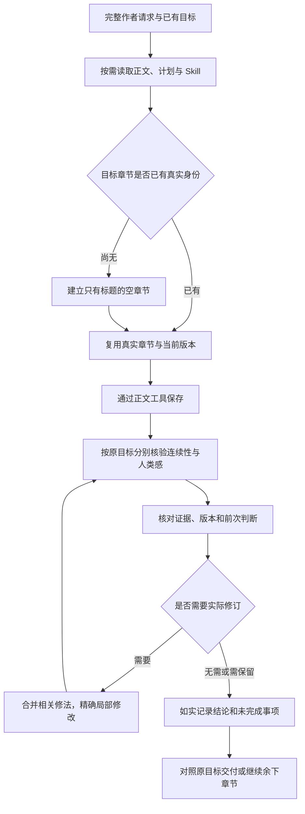

# 章节创作、复查与真实进展 / Writing collaboration

## 职责与证据

主 Agent 结合完整作者请求决定工作，并保留多章的未完成目标。以下是协作关系，不是后端权限阶段；普通保存与检查通过始终分开。

| 对象 | 负责的事实 | 不代表的结论 |
|---|---|---|
| `chapter_create` | 空章身份、标题和结构 | 正文已写完 |
| `chapter_write` / 片段工具 | 当前章节实际正文变更 | 质量已经通过 |
| 连续性报告 | 事实、时空、人物知识、因果及来源 | 人类感检查已完成 |
| 人类感报告 | 有原文证据的表达质量判断 | 每条建议都必须修改 |
| Skill 目录 | 可用名称、版本、适用阶段 | 已加载或实际使用 |
| 已加载 Skill | 当前子任务的方法说明 | 已执行全部步骤 |
| 任务清单 | 原任务的组织与待办 | 全目标已完成的证明 |

新主模型工具视图不提供建章正文参数。历史冻结调用仍按原参数和原回执执行，不丢弃已取得的旧正文。新调用先取得空章 ID，再用正文工具保存；继续执行时复用已有身份、正文和报告，不重复创建或覆盖已完成内容。

## 复查协作

复查保持稳定的判断标准。前次报告是历史判断，不能当成故事事实或当前版本通过证据。比较前次问题、实际改动、当前正文和前文依赖，区分旧问题仍存、修订引入的新问题、首轮漏检、旧判断不成立与可选建议。新发现的真实问题继续处理；不通过忽略漏检、固定轮数、降低标准或强制清零制造收敛。

独立连续性报告携带版本化的复检基线及来源快照。相同完整检查协议、原任务和实际依赖下，可复用已完成且费用已核对的报告；模型的关注提示不会单独扩大检查范围。旧报告没有新完整检查协议证明时，不将它升级为该协议的报告。正文、前文顺序或依赖变化后独立核验，旧稿意见不能认证新稿。

独立人类感检查在新请求构造时读取同任务的真实旧版判断；历史判断不改变旧冻结请求、模型、价格或版本哈希。完整性、意见、实际修订和最终版本复核分别记录。

定位失败保留整批未写入的事实，给出失败片段序号、匹配数量/位置或重叠片段。Agent 在同一目标的当前原文中扩大锚点或合并重叠修法；不能任取一个匹配、猜另一个章节或用整章覆盖绕过局部范围。

## 上下文、恢复与展示

只读协作快照来自原任务的实际工具/持久回执和真实报告；逐章展示空章或保存正文、连续性状态及人类感状态。它不调度付费检查，不新增授权、阶段门或完成判定。新模型边界刷新该快照；已经准备或结果未知的请求保持原样。正文和前文版本、对象归属、租约、取消、真实选区及未知费用校验继续有效。

用户可见的进展摘要由实际工具状态与回执生成，分别表述准备、进行中、成功、失败及尚待处理。模型内部推演保留在内部协议中，不从其最后一句生成摘要，也不在展开区显示。公开事件、历史恢复、浏览器缓存和渲染使用同一投影。仅进展回执规范化传输换行，用户原文、正文、引用和工具参数不被改写。私有模型活动标记保留既有实时与重连响应计时，不把活动当成动作完成。

## 官方参考与验证边界

- [OpenAI Skills 说明](https://developers.openai.com/plugins/concepts/skills)：工具提供动作，Skill 提供组合方法；按需发现和加载。
- [Codex goals](https://developers.openai.com/cookbook/examples/codex/using_goals_in_codex)：保留目标、验证面和约束，以证据判断完成。
- [迭代修复工作流](https://developers.openai.com/cookbook/examples/codex/build_iterative_repair_loops_with_codex)：复查、集中修订与独立验证分别执行。
- [Codex Skill 目录源码](https://github.com/openai/codex/blob/e934edd68c73da93486320c77af672a015b4514a/codex-rs/ext/skills/src/catalog_prompt.rs)和[目标继续模板](https://github.com/openai/codex/blob/e934edd68c73da93486320c77af672a015b4514a/codex-rs/ext/goal/templates/goals/continuation.md)：研究固定在该源码修订，不能据此声称 Codex 没有权限或预算边界。

确定性回归验证工具视图、历史请求兼容、实际回执、依赖失效、定位恢复和展示。它们不等于收费模型实跑、文学质量验收或设备验收。完整发布仍需原同 SHA 的四闸、真实隔离 PostgreSQL 零跳过、Agent eval 和双依赖审计。

## English contract

The primary agent retains the complete author objective and observes each chapter's real saved identity, body and separate review results. New model calls create an empty chapter before writing through its returned ID; immutable historical combined calls retain their original execution contract. Discovery metadata, loaded instructions and actual use are distinct.

Review uses a stable rubric, prior judgments and actual versioned changes. It distinguishes persistent issues, regressions, previously missed issues, retracted judgments and optional advice. Real new issues remain visible; neither a fixed iteration count nor a save/report gate produces completion. Current-source complete reports may be reused only with compatible protocol, task, dependencies and known accounting. Frozen requests and prices remain unchanged.

Public progress derives from actual tool states and receipts across streaming, history, cache and rendering. Private reasoning is never a progress summary. Activity metadata preserves response clocks without claiming completion. Advisory task context adds no permission, fee, semantic progress or completion authority. Release gates and honest acceptance limitations remain unchanged.
